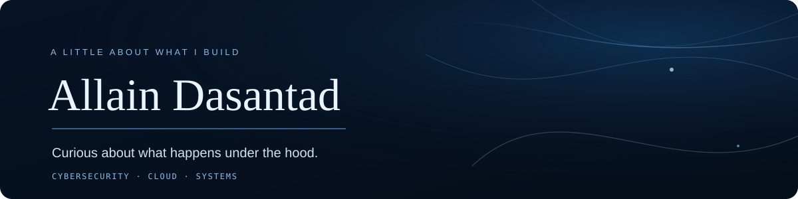

  

  <a href="https://github.com/AllainDasantad">GitHub</a>
  &nbsp;·&nbsp;
  <a href="https://github.com/AllainDasantad?tab=repositories">Things I'm building</a>

## Hey, I'm Allain.

I'm a student at **CMKL University** who likes understanding how technology works beyond the surface.

I keep coming back to cybersecurity, Linux, networking, and cloud infrastructure. I enjoy taking something apart, figuring out why it behaves the way it does, and trying to build a small tool or experiment of my own.

I'm still learning, and that's a big part of the fun. This profile is where I keep some of that journey: projects, experiments, coursework, and the occasional idea that turns into something bigger.

## What I'm exploring

- **Cybersecurity** — network analysis, security fundamentals, and learning how systems fail so I can understand how to protect them.
- **Cloud** — building a stronger foundation in AWS, infrastructure, and cloud security.
- **Linux & systems** — spending time in NixOS, exploring the command line, and learning how the pieces fit together.
- **Programming** — using code to solve practical problems and make ideas tangible.

## A few things I've been building

These are learning projects, not claims of finished products. I like sharing the process as much as the result.

| Project | What it is |
| --- | --- |
| [NetSniff](https://github.com/AllainDasantad/netsniff) | A desktop network analyzer I'm building with React, TypeScript, Rust, and Tauri. The goal is to make packet inspection and traffic analysis easier to explore. |
| [Nmap-scanner](https://github.com/AllainDasantad/Nmap-scanner) | A small Python TCP port-scanning project inspired by one of the fundamentals of network discovery. |

I'm adding to this list as projects become ready to share. Some experiments are messy; that's usually where I learn the most.

## Tools I spend time with

**Languages**  
Python · C · C++ · Rust · TypeScript · JavaScript

**Systems & infrastructure**  
NixOS · Linux · Git · AWS (learning) · Docker

**Web & development**  
React · Tauri · GitHub

The list is a snapshot, not a checklist. I'm more interested in understanding a tool well than collecting logos.

## The little green squares

I like having a visible record of showing up, even when the work is just a small fix, a lab, or an experiment.

  

## Say hello

If you're also learning about security, Linux, cloud, or systems, I'd be happy to connect and compare notes.

  <a href="https://github.com/AllainDasantad">Find me on GitHub</a>

  Still curious. Still learning. Still building.

