

  

  
  
  

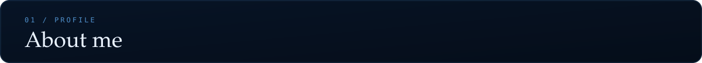

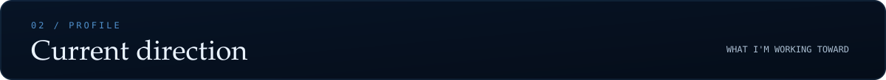

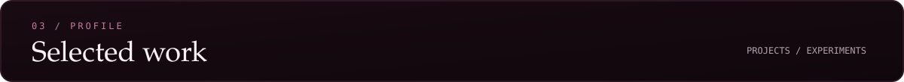

<a href="https://github.com/AllainDasantad/netsniff"></a>

  

<a href="https://github.com/AllainDasantad/sshguard">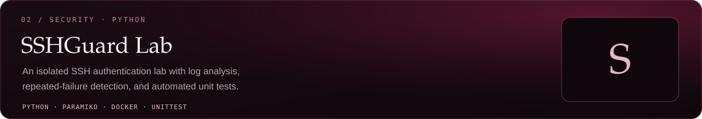</a>

  

<a href="https://github.com/AllainDasantad/pypentesting">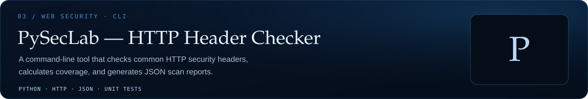</a>

  

<a href="https://github.com/AllainDasantad/MACspoofing">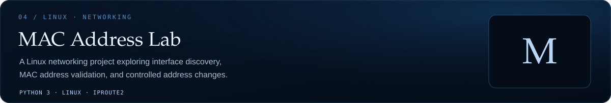</a>

  
  

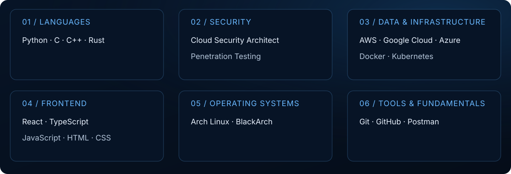

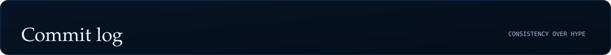

  
  

  

  

<a href="https://github.com/AllainDasantad">
  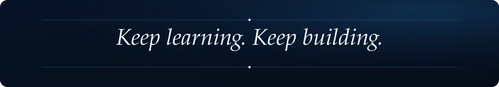
</a>
