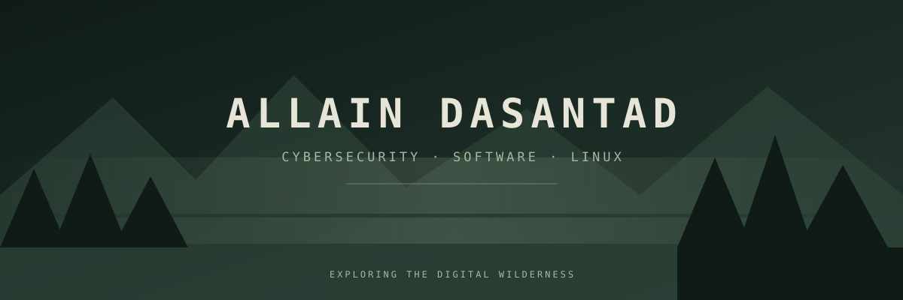

# `ALLAIN@WILDERNESS:~$`

<p align="center">
  
</p>

<p align="center">
  <code>INDEPENDENT DEVELOPER</code> · <code>SYSTEMS EXPLORER</code> · <code>CYBERSECURITY</code>
</p>

<p align="center">
  <i>Exploring the digital wilderness, one system at a time.</i>
</p>

---

## `01 // WHOAMI`

```bash
$ whoami
allain_dasantad

$ cat /etc/identity
Name       : Allain Dasantad
Environment: Arch Linux
Editor     : Neovim
Interests  : Cybersecurity, Cloud & Systems
Philosophy : Understand how things work.
```

I'm an independent developer interested in understanding technology beneath the surface.

I explore computer security, build practical tools, experiment with Linux, and study how infrastructure works.

My goal is to become an engineer capable of building, investigating, and securing complex systems.

## `02 // CURRENT_EXPEDITION`

```text
[ IN PROGRESS ]

01. CYBERSECURITY
    ├── Network security
    ├── Attack investigation
    └── Malware analysis

02. CLOUD INFRASTRUCTURE
    ├── Microsoft Azure
    ├── Cloud architecture
    └── Infrastructure security

03. SYSTEMS PROGRAMMING
    ├── C
    ├── Rust
    └── Operating systems

04. LINUX ENGINEERING
    ├── Arch Linux
    ├── System administration
    └── Terminal environments
```

## `03 // EQUIPMENT`

**Languages**

<p>
  
  
  
  
</p>

**Environment & tools**

<p>
  
  
  
  
  
</p>

## `04 // FIELD_NOTES`

*Selected experiments and engineering projects.*

| Repository | Description | Language |
|---|---|---|
| [psa-rust](https://github.com/AllainDasantad/psa-rust) | Network packet sniffer | Rust |
| [networkpacketsniff](https://github.com/AllainDasantad/networkpacketsniff) | Network packet analysis | Python |
| [MACspoofing](https://github.com/AllainDasant/MACspoofing) | MAC address lab utility | Python |

More experiments are being explored.

## `05 // CAMPFIRE`

*Activity from the expedition.*

<p align="center">
  
  
</p>

## `06 // TRANSMISSION_LOG`

```text
[ SYSTEM MESSAGE ]

There is always another system to understand.
Another vulnerability to investigate.
Another mountain to climb.

Stay curious.
Build quietly.
Explore deeply.

[ END OF TRANSMISSION ]
```

<p align="center">
  <sub>NORDIC WILDERNESS · ARCH LINUX · EST. 2026</sub>
</p>
