

  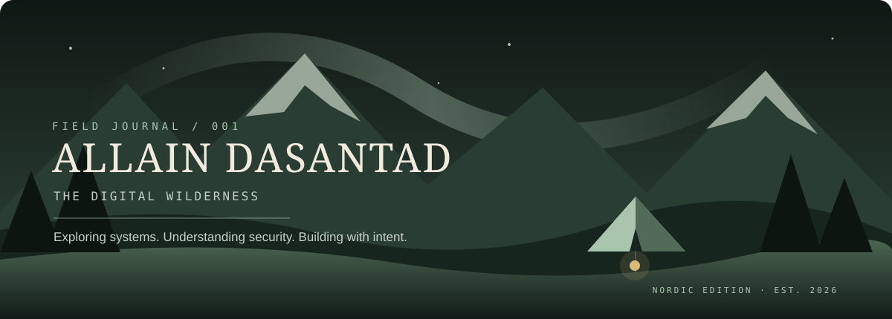

  <code>CYBERSECURITY</code> &nbsp;·&nbsp; <code>NETWORKING</code> &nbsp;·&nbsp; <code>CLOUD INFRASTRUCTURE</code> &nbsp;·&nbsp; <code>SYSTEMS</code>

  <i>Exploring systems. Understanding security. Building with intent.</i>

---

  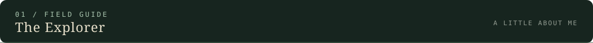

  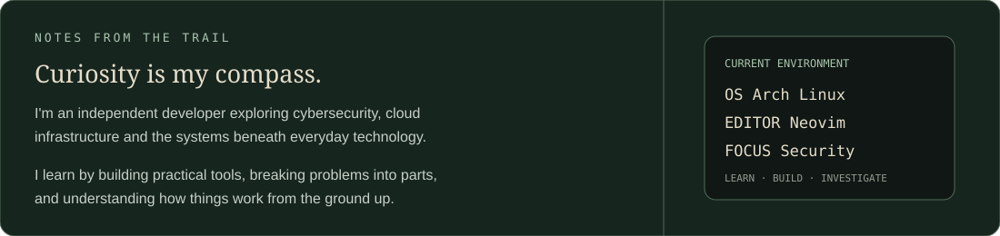

  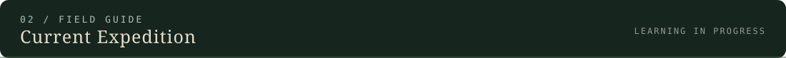

  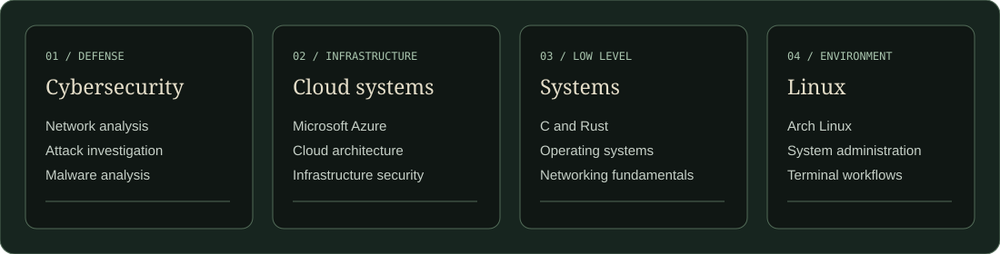

  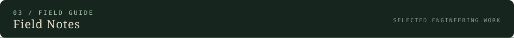

  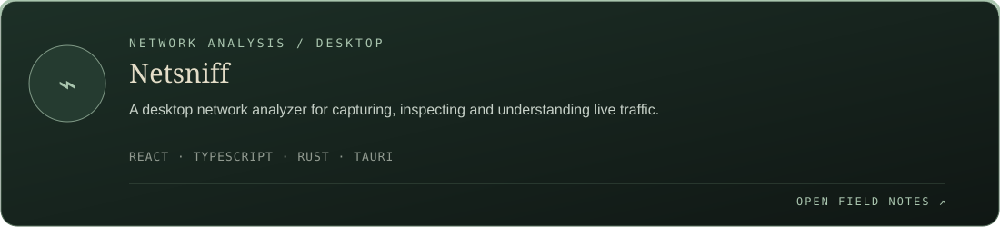

  <a href="https://github.com/AllainDasantad/netsniff">View repository ↗</a>

  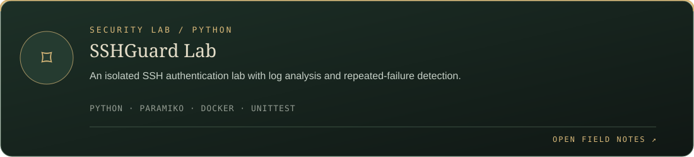

  <a href="https://github.com/AllainDasantad/sshguard">View repository ↗</a>

  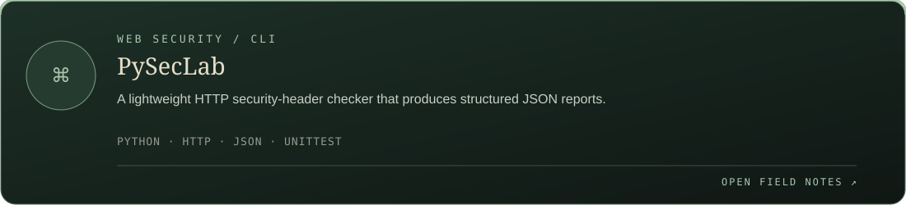

  <a href="https://github.com/AllainDasantad/pypentesting">View repository ↗</a>

  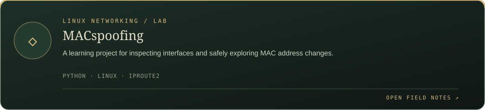

  <a href="https://github.com/AllainDasantad/MACspoofing">View repository ↗</a>

  ALSO IN THE FIELD: <a href="https://github.com/AllainDasantad/Nmap-scanner">Nmap-scanner</a> · a small TCP connect scanner written in Python.

  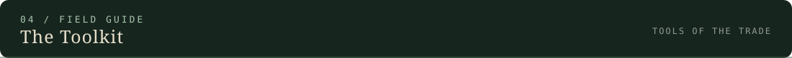

  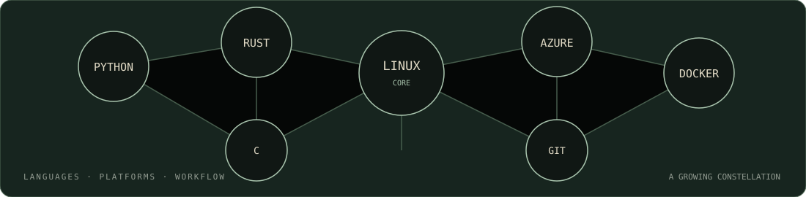

  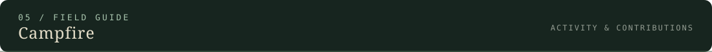

  
  

  

  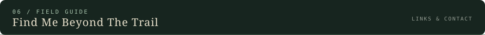

  <a href="https://github.com/AllainDasantad">GitHub · @AllainDasantad</a>

  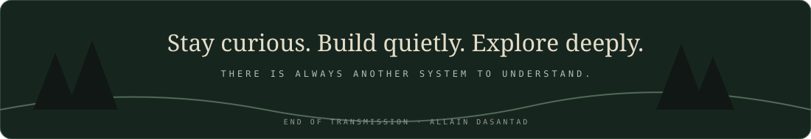

