  
  
  

  

I’m a student at CMKL University interested in cybersecurity, cloud infrastructure, networking, and systems. I learn best by getting hands-on: reading how something works, trying it, and building small tools around it.

At the moment I’m exploring Azure security, network analysis, and Linux. I write code in Neovim and want to get better by understanding the code I write, one project at a time.

- [SSHGuard Lab](https://github.com/AllainDasantad/sshguard) — a Python lab for analyzing SSH authentication logs and detecting repeated failed logins.
- [PySecLab](https://github.com/AllainDasantad/pypentesting) — a small Python tool that checks common HTTP security headers and reports the results.

  

🌙 Learning quietly. Building steadily.

